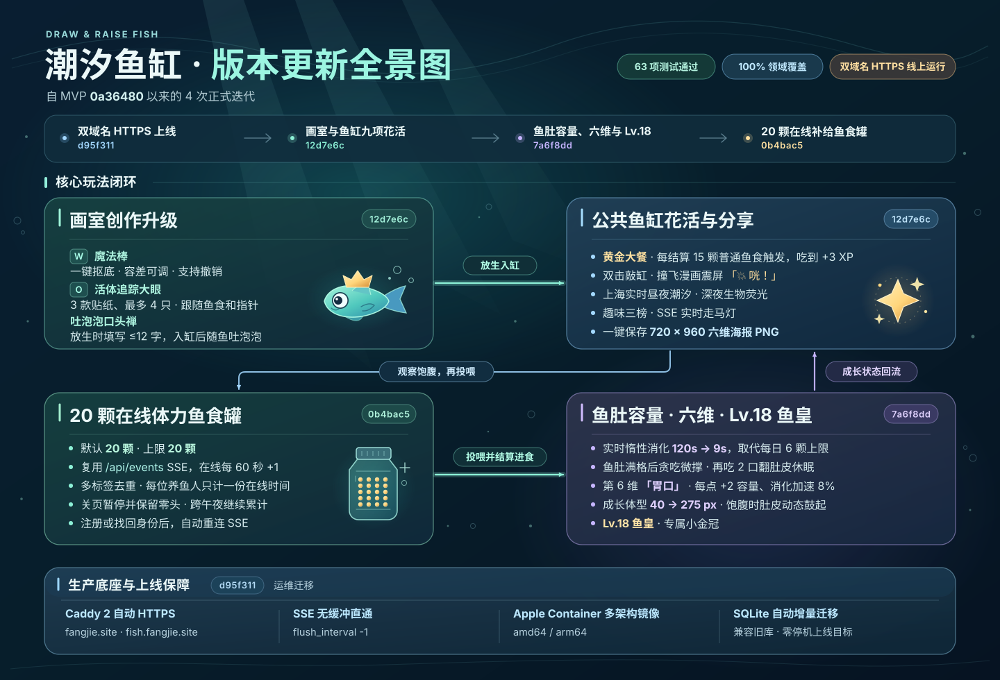

# 潮汐鱼缸（Draw & Raise Fish）版本更新报告

> **覆盖范围**：自 MVP（`0a36480`）至当前线上版本（`0b4bac5`），共 **4 次正式迭代**
> **线上地址**：https://fangjie.site/ · https://fish.fangjie.site/
> **质量基线**：TypeScript 前后端 0 报错 · **63 / 63** 自动化测试通过 · `shared/domain.ts` 语句/分支/函数/行 **100% 覆盖**

---

## 全景更新图

---

## 迭代总览

| 序号 | Commit | 更新主题 | 核心变化 | 变更规模 |
| :--- | :--- | :--- | :--- | :--- |
| **1** | `d95f311` | **双域名 HTTPS 生产上线** | Caddy 2 自动 TLS 证书、双域名路由与 SSE 无缓冲直通 | 4 files (`+32 / -3`) |
| **2** | `12d7e6c` | **9 大画室与鱼缸花活升级** | 魔法棒抠底、活体大眼、口头禅、敲缸、撞飞特效、黄金大餐、三榜走马灯、昼夜潮汐、晒鱼海报 | 26 files (`+1640 / -175`) |
| **3** | `7a6f8dd` | **鱼肚容量、六维「胃口」与 Lv.18 鱼皇** | 移除每日 6 颗上限，改为鱼肚容量 + 实时消化、新增第 6 维胃口、鼓肚皮与鱼皇小金冠 | 17 files (`+1076 / -334`) |
| **4** | `0b4bac5` | **20 颗在线体力条鱼食罐** | 改为默认/上限 20 颗、复用 SSE 在线每分钟 +1、多标签去重、离线暂停、不跨天重置 | 12 files (`+645 / -147`) |

---

## 分模块更新明细

### 一、画室创作体验升级（`12d7e6c`）

- **魔法棒一键抠底（`W` 工具）**：支持对导入图片执行泛洪抠底，附带容差滑块与完整撤销/重做栈，照片/表情包能快速变成干净的透明小鱼。
- **会转动的贴纸大眼（`O` 工具）**：提供「呆萌 / 死鱼 / 凶狠」3 种款式，单鱼最多贴 4 只；裁剪导出时精确映射相对坐标，入缸后随鱼身波浪偏移并实时追看**黄金大餐 > 鱼食 > 鼠标指针 > 游动方向**。
- **放生吐泡泡口头禅**：放生下水时可填写 ≤12 字口头禅，在公共鱼缸内错峰冒出对话气泡，并持久展示在鱼档案与海报中。

### 二、20 颗在线体力条鱼食罐（`0b4bac5`）

- **告别零点重置，改为体力槽机制**：鱼食罐默认与上限均为 **20 颗**，投放即扣除，跨上海零点不再重置。
- **复用 `/api/events` SSE 精确在线恢复**：
  - 仅在养鱼人已登录且页面保持打开、当前鱼食 `< 20` 颗时累计在线时长，每满 **60 秒**自动 `+1` 颗，并通过私有 SSE 事件 `rations_updated` 实时推送（不向其他玩家广播）。
  - **多标签去重防刷**：同一养鱼人同时打开多个浏览器标签页共用 1 份在线进度，不会出现多倍回粮。
  - **离线暂停与断点续计**：最后一个标签页关闭（`pagehide`）或服务优雅停机时立刻把不足 1 分钟的零头写回 SQLite 并停表；离线期间 0 增长，重新打开页面后接着之前的倒计时继续累计。
- **无缝登录重连与实时倒计时**：访客完成注册或通行码找回后，前端自动重建携带身份 Cookie 的 SSE 连接，无需手动刷新页面；鱼食罐未满时显示 `剩余 X/20 · Ns后+1`。

### 三、鱼肚容量、六维「胃口」与 Lv.18「鱼皇」养成重构（`7a6f8dd`）

- **取消单鱼每日 6 颗上限，改为实时惰性消化**：
  - 基础肚量随等级从 **2 格（Lv.1）** 成长到 **38 格（Lv.18）**，叠加胃口属性最高达 **50 格**。
  - 单格消化耗时从 **120 秒（Lv.1）** 缩短至 **18 秒（Lv.18）**，满胃口最快 **9 秒/格**。
  - 肚子吃满后继续贪吃：第 1 口进入「微撑警告」，第 2 口直接**翻肚皮休眠**（240 秒 → 最快 36 秒），休眠结束清空肚子恢复活力。
- **五阶段等级体系扩至 Lv.18「鱼皇」**：
  - 升级阶梯扩展至 **Lv.18**（总经验 `33`、可分配属性点 `17`、体型从 `40px` 线性长到 `275px`），新增最高阶段 `emperor`（**鱼皇**）。
  - 鱼皇在公共鱼缸、档案预览和分享海报中均佩戴专属**水中浮游小金冠**。
- **五维升级六维，新增「胃口 (`appetite`)」**：
  - 每点胃口提供 **+2 格子容量**与 **8% 消化/休眠加速**，搭配 13 种单维/双修/均衡流派称号（如 `深海无底洞`、`霸王餐恶霸`、`深海吸尘器`、`六边形战神`）。
- **鱼身动态鼓肚皮 & 档案消化面板**：
  - 16 切片网格渲染加入中段高斯腹部鼓胀，饱腹度 >55% 后游速平滑变沉，翻肚皮时倒浮水面并闭眼冒 `💤` 与精准到秒的翻身倒计时。
  - 档案页升级为实时跳动的「鱼肚子面板」，暂存加点时即时预览扩容与消化提速效果。

### 四、公共鱼缸互动花活与社交分享（`12d7e6c`）

- **流派视觉 & 撞飞漫画反馈**：高感知索敌冒 `！`，高爆发冲刺带气泡拖尾，强壮大鱼撞飞对手弹出 `💥 咣！` 爆炸贴纸、轻微震屏、`bonk` 音效与头顶眩晕星星 `✦`。
- **双击敲鱼缸**：非喂食态双击水面触发涟漪波纹与敲玻璃音效，震散半径内未撑翻的鱼群（翻肚皮休眠的鱼懒得理会）。
- **天降黄金大餐**：全缸每累计结算 **15 颗**普通鱼食自动掉落一颗黄金大餐（管理员也可手动触发），抢到额外获得 **+3 XP**，采用原子事务结算；若刚好撑翻还会触发专属走马灯文案。
- **上海实时昼夜潮汐光影**：默认按上海当地时间自动切换「清晨 / 午后 / 黄昏 / 深夜（带离屏缓存的生物荧光微光）」，顶栏支持随时手动切换。
- **趣味三榜 & 实时走马灯**：新增 `GET /api/tank/leaderboard`（今日干饭王 / 全缸恶霸 / 深海巨物）与 SSE `tank_ticker` 顶部播报条。
- **一键晒鱼海报 PNG**：鱼档案页一键生成 `720×960` 高清 PNG 海报，包含流派称号、六边形六维雷达图、带贴纸眼与皇冠的小鱼、口头禅、战绩与站点网址。

### 五、生产部署与运维保障（`d95f311` + 持续滚动发布）

- **Caddy 2 自动 HTTPS 双域名**：通过 `Caddyfile` 同时代理 `fangjie.site` 与 `fish.fangjie.site`，自动签发并续期 Let's Encrypt 证书。
- **SSE 专项优化**：对 `/api/events` 跳过 gzip 压缩并设置 `flush_interval -1`，保障多端实时状态与鱼食补给推送无缓冲延迟。
- **多架构容器 & 平滑数据库迁移**：通过 Apple `container` CLI 构建并推送 `linux/amd64` + `linux/arm64` 双架构镜像至阿里云 ACR；每次版本升级均通过 `PRAGMA table_info` 自动补迁新增字段，线上原有 SQLite 数据与鱼绘资产零丢失。
